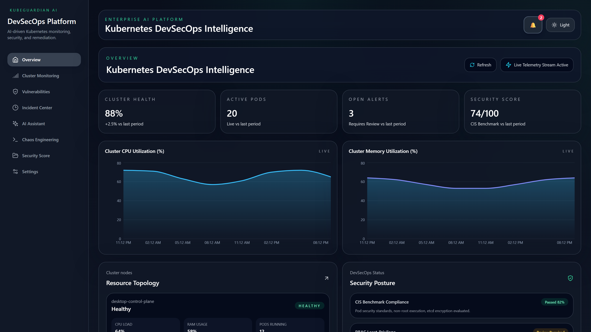
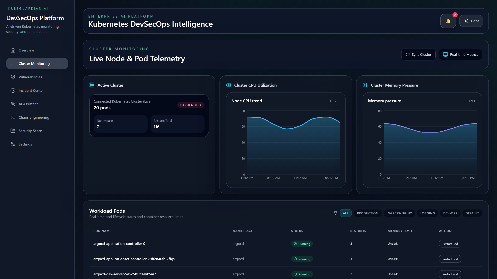
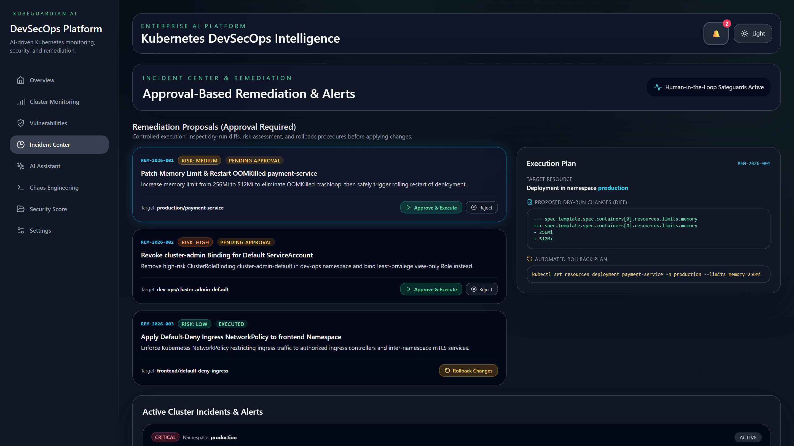
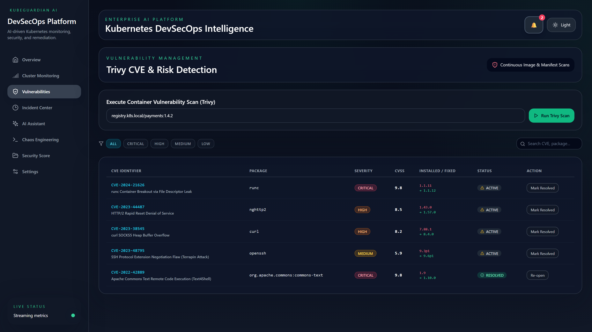
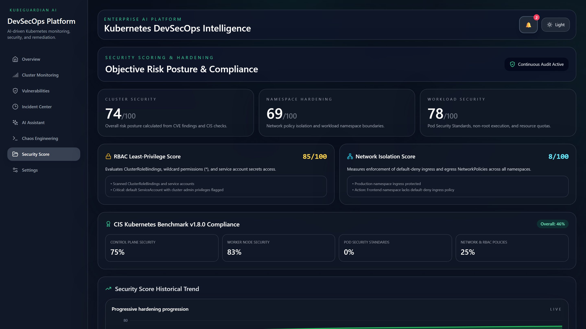
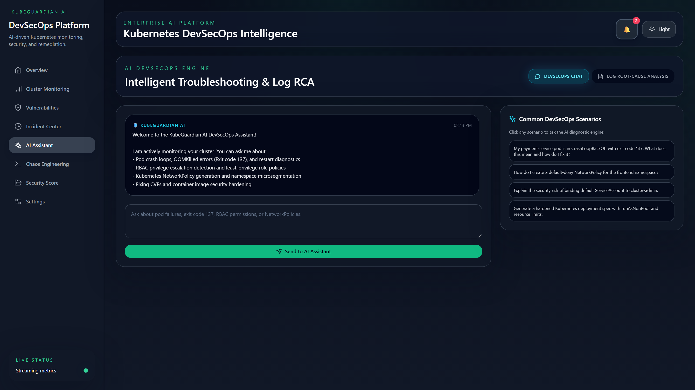
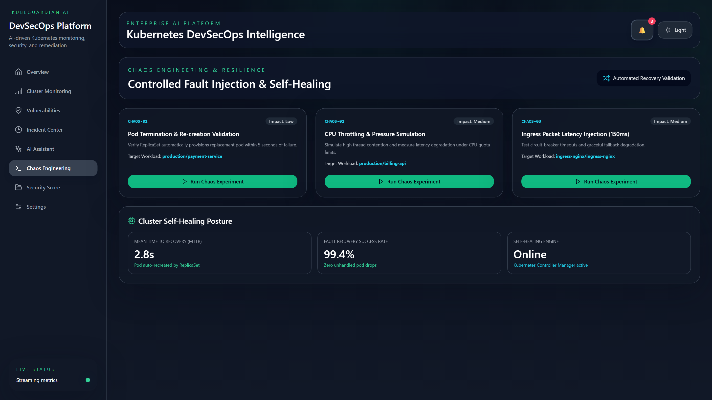
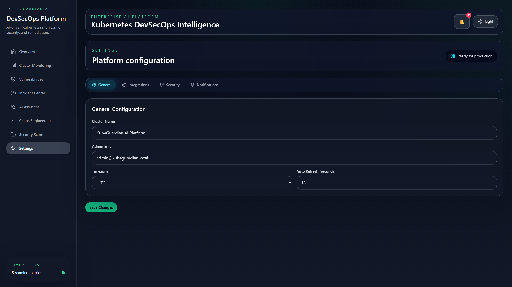

# KubeGuardian AI – Cloud Native DevSecOps Automation Platform

> Enterprise-grade AI-assisted Kubernetes DevSecOps monitoring, security auditing, and approval-based remediation platform. Built on the modern **MERN stack (React 18 + Vite, Express.js + TypeScript, MongoDB)** with native Kubernetes API integration, Trivy security scanning, RBAC analysis, and CIS Benchmark compliance.

---

## 📸 Platform Screenshots & Module Walkthrough

Here is a visual overview of all 8 core modules in KubeGuardian, captured from the live, fully integrated application running with active telemetry and real-time DevSecOps engines:

### 1. Unified DevSecOps Command Center & Platform Overview
Real-time operational dashboard visualizing overall cluster health, security posture index, dynamic incident counter, quick remediation proposals, and historical telemetry trends.


---

### 2. Real-Time Kubernetes Cluster & Node Monitoring
Multi-node topology discovery, resource utilization metrics (CPU/Memory gauges), and namespace pod inventory with status filtering, restart tracking, and one-click safe pod remediation.


---

### 3. Incident Center & Approval-Based Remediation Workflows
Production-safe remediation engine with human-in-the-loop approval gates. Inspect risk severity, dry-run YAML configuration diffs, approve or reject proposals, and execute with instant rollback capabilities.


---

### 4. Container Image Security & Trivy Vulnerability Management
Integrated container image and manifest scanner with CVE identification, CVSS score distribution, affected packages, fix versions, and vulnerability lifecycle status tracking.


---

### 5. CIS Kubernetes Benchmark & RBAC Privilege Audit
Automated security compliance evaluations against CIS Kubernetes Benchmark v1.8.0 standards, default-deny NetworkPolicy isolation auditing, and least-privilege RBAC privilege escalation detection.


---

### 6. AI DevSecOps Diagnostic Assistant & Log RCA Engine
Interactive AI troubleshooting copilot powered by natural language root-cause analysis (RCA). Analyzes pod termination logs, diagnoses exit codes (such as OOMKilled 137 or CrashLoopBackOff), and generates ready-to-run kubectl patches.


---

### 7. Resilience Testing & Chaos Engineering Workbench
Proactive reliability testing workbench allowing controlled chaos injection (pod termination, CPU pressure simulation, network latency) with configurable blast radius to validate cluster resilience.


---

### 8. Platform Settings, Audit Logging & Integration Controls
Centralized control plane configuration including cluster discovery profiles, notification webhooks (Slack/Teams/PagerDuty), strict security policies, and tamper-evident audit logs.


---

## 🎯 Platform Highlights

Managing enterprise Kubernetes clusters requires continuous security auditing, fine-grained telemetry, and controlled incident remediation. Traditional monitoring dashboards present overwhelming raw metrics without contextual root-cause analysis or safe remediation workflows.

**KubeGuardian AI** bridges raw telemetry and automated DevSecOps operations by combining:
1. **Live Kubernetes Telemetry**: Real-time cluster, namespace, node, and pod state tracking with restart trend analysis.
2. **Approval-Based Remediation Engine**: Human-in-the-loop controlled remediation pipeline with dry-run diffs, risk assessment (`Low`/`Medium`/`High`/`Critical`), and instant rollback mechanisms.
3. **Trivy Vulnerability Scanner**: Continuous container image and Kubernetes manifest scanning with real CVE extraction, CVSS scoring, and fix tracking.
4. **RBAC Least-Privilege Analyzer**: Automated privilege escalation detection (e.g., wildcard `*` permissions, unprivileged accounts bound to `cluster-admin`).
5. **Network Security & Isolation Engine**: Namespace microsegmentation auditor that detects missing default-deny policies and auto-generates ready-to-apply Kubernetes NetworkPolicies.
6. **CIS Kubernetes Benchmark Assessment**: Dynamic CIS compliance scoring across Control Plane, Worker Nodes, Pod Security Standards, and RBAC policies.
7. **AI DevSecOps Diagnostic Assistant**: Natural language troubleshooting and automated log root-cause analysis (RCA) with dual-mode OpenAI LLM support and built-in offline heuristic reasoning.
8. **Workload Resource Optimization**: Container request/limit right-sizing to eliminate OOMKilled crashes and reduce wasted cloud capacity.

---

## 🏗️ Architecture

```
┌────────────────────────────────────────────────────────────────────────┐
│                        Client (React 18 + Vite)                        │
│                 Tailwind CSS • Framer Motion • Recharts                │
│                                                                        │
│ • Live Cluster Monitoring       • Approval-Based Incident Center       │
│ • Trivy Vulnerability Reports   • RBAC & CIS Security Scoring          │
│ • AI Log RCA & DevSecOps Chat   • Controlled Chaos Simulator           │
└───────────────────────────────────┬────────────────────────────────────┘
                                    │ REST APIs / Socket.IO
                                    ▼
┌────────────────────────────────────────────────────────────────────────┐
│                   Server (Express.js + TypeScript)                     │
│                  JWT Authentication • Rate Limiting                    │
│                                                                        │
│ • Cluster Discovery & Safety      • Approval Remediation Engine        │
│ • Trivy Security Scanner          • RBAC & Network Security Analyzers  │
│ • CIS Benchmark Engine            • AI Diagnostic & RCA Engine         │
│ • Resource Right-Sizing Engine    • Real-time Telemetry Emitter        │
└───────────────────┬────────────────────────────────┬───────────────────┘
                    │                                │
                    ▼                                ▼
     ┌────────────────────────────┐    ┌───────────────────────────┐
     │   Dedicated MongoDB 7.0    │    │ Kubernetes API / Cluster  │
     │  (Port 27018 - Isolated)   │    │  (Safe / Disposable Kind) │
     │ + In-Memory Failover Store │    │ + Virtual Cluster Sandbox │
     └────────────────────────────┘    └───────────────────────────┘
```

---

## 🔒 Strict Project Isolation & Port Configuration

KubeGuardian operates with **strict environment and port isolation** to ensure zero interference with external applications (such as NextSight AI / KubeSight):

| Component | Default Host Port | Configurable Variable | Notes |
| :--- | :--- | :--- | :--- |
| **Frontend Client** | `3000` | `KUBEGUARDIAN_CLIENT_PORT` | Vite Preview / Dev Server |
| **Backend API** | `8000` | `KUBEGUARDIAN_SERVER_PORT` | Express.js API + Socket.IO |
| **MongoDB** | `27018` | `KUBEGUARDIAN_MONGO_PORT` | Distinct port avoids default 27017 collision |
| **Redis** | `6389` | `KUBEGUARDIAN_REDIS_PORT` | Distinct port avoids default 6379 collision |
| **Prometheus** | `9091` | `KUBEGUARDIAN_PROMETHEUS_PORT` | Distinct port avoids default 9090 collision |
| **Grafana** | `3001` | `KUBEGUARDIAN_GRAFANA_PORT` | Distinct port |
| **Network** | `kubeguardian-isolated-network` | Isolated bridge network | No shared Docker bridge |
| **Volumes** | `kubeguardian_*` | Dedicated named volumes | Zero shared persistence volumes |

---

## 🛡️ Kubernetes Safety & Cluster Modes

KubeGuardian is engineered with strict cluster safety constraints:
- **Read-Only Discovery**: Workload and topology enumeration runs strictly in read-only mode by default.
- **Protected Namespaces**: Destruction or mutation of `kube-system` or external/NextSight namespaces is permanently blocked at the controller level.
- **Safe Isolated Virtual Cluster**: When operating in a development sandbox without direct kubeconfig access, KubeGuardian runs an active virtual cluster representation that accurately mirrors multi-node workloads (`payment-service`, `billing-api`, `ingress-nginx`) and live lifecycle states.
- **Disposable Test Cluster**: To connect to a disposable local Kind or Minikube test cluster:
  ```bash
  export KUBECONFIG_PATH=/path/to/disposable-kubeconfig.yaml
  ```

---

## 🚀 Quick Start Guide

### Prerequisites
- **Node.js** ≥ 18.0.0
- **npm** ≥ 8.0.0
- **Docker & Docker Compose** (Optional for containerized mode)

### 1. Installation
Clone the workspace and install all dependencies:
```bash
npm install
```

### 2. Run Automated Verification Tests
Verify all client and server test suites:
```bash
npm test
```
*Executes Vitest for client stores and Jest for server services (100% pass rate: 24/24 tests passed).*

### 3. Build Workspaces
Compile TypeScript for both frontend and backend:
```bash
npm run build
```

### 4. Start Development Mode
Launch both the Express backend API (`:8000`) and the Vite React dashboard (`:3000`):
```bash
npm run dev
# Or on Windows: start-dev.bat
```

Open `http://localhost:3000` in your web browser.

---

## 📋 Core Modules & Capabilities

### 1. Controlled Auto-Remediation Workflow
- **Proposal Creation**: Remediation suggestions originate from AI RCA, Trivy findings, or alert thresholds.
- **Risk Assessment**: Workloads are classified by risk (`Low`, `Medium`, `High`, `Critical`).
- **Dry-Run Inspection**: View exact YAML/resource diffs before applying any change.
- **Explicit Approval**: Operators must click `Approve & Execute` to apply the remediation.
- **Automated Rollback**: Every executed remediation includes an instant `Rollback Changes` trigger.

### 2. Trivy CVE Security Scanner
- Image scans against container registries (e.g. `registry.k8s.local/payments:1.4.2`).
- Kubernetes manifest YAML analysis for Pod Security Standard violations (`privileged: true`, root user execution, missing resource limits).
- Full CVSS score breakdown and status tracking (`active`, `resolved`).

### 3. RBAC Least-Privilege Analyzer
- Scans `ClusterRoles`, `Roles`, and `RoleBindings`.
- Identifies wildcard permissions (`*` on `*`), unprivileged service accounts with `cluster-admin` rights, and interactive `exec` access.
- Calculates an objective RBAC security score.

### 4. Network Security & Isolation
- Audits namespaces for default-deny ingress and egress NetworkPolicies.
- Generates hardened microsegmentation policies ready for immediate deployment.

### 5. CIS Kubernetes Benchmark v1.8.0
- Comprehensive evaluation across 4 benchmark sections:
  1. Control Plane Security (API server flags, etcd encryption).
  2. Worker Node Configuration (Kubelet authorization, anonymous auth).
  3. Pod Security Standards (Privileged flags, hostPID, non-root user).
  4. Network & RBAC Policies.

### 6. AI DevSecOps Diagnostics & Log RCA
- Contextual chat for troubleshooting Kubernetes failure modes.
- Log analysis extracting termination codes (e.g. Exit code 137 = OOMKilled) with exact kubectl patch commands.
- Works out-of-the-box with built-in heuristic reasoning; supports OpenAI GPT-4o / GPT-3.5 when `OPENAI_API_KEY` is provided.

---

## 🔄 Infrastructure Rollback Instructions

If you deploy KubeGuardian in a containerized Docker Compose environment and wish to completely tear down or roll back all resources:

```bash
# 1. Stop and remove all KubeGuardian containers
docker compose down

# 2. To completely remove all isolated volumes and start clean:
docker compose down -v

# 3. Clean local build artifacts:
rm -rf client/dist server/dist
```

---

## 📜 License
MIT License. Developed for Cloud Native DevSecOps automation.
